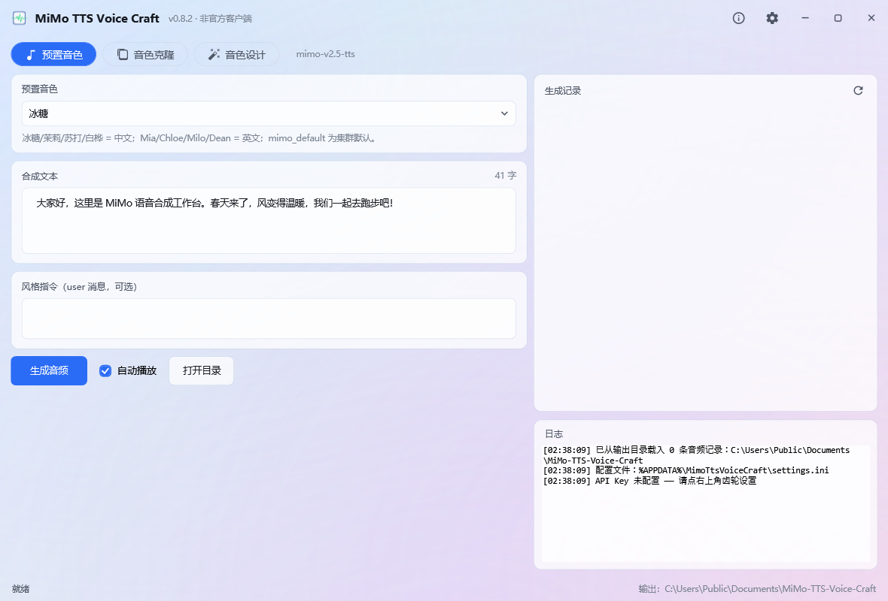
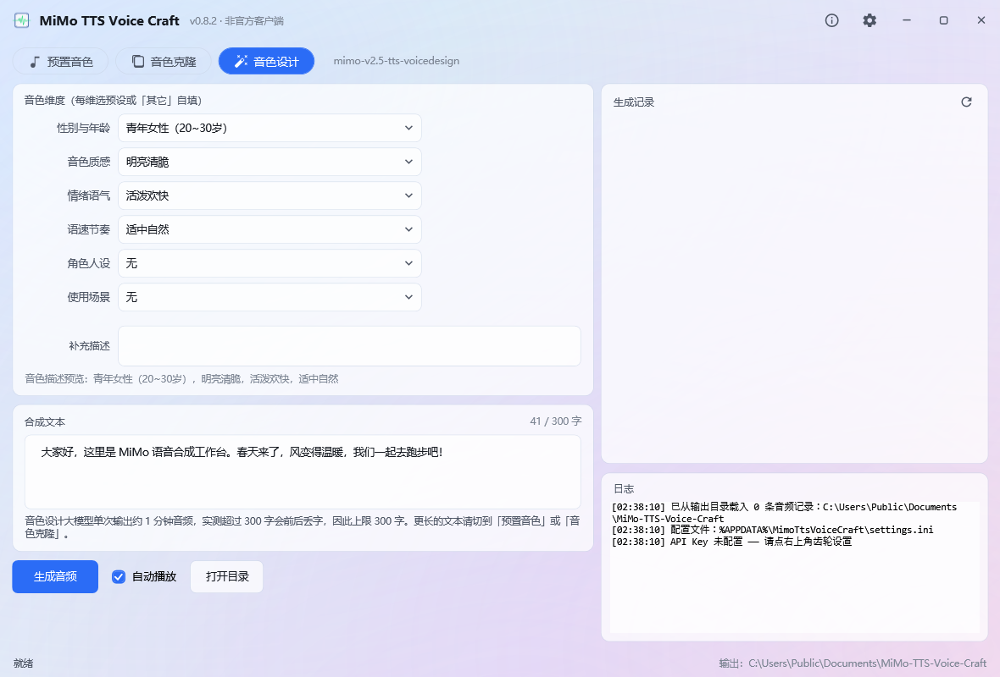
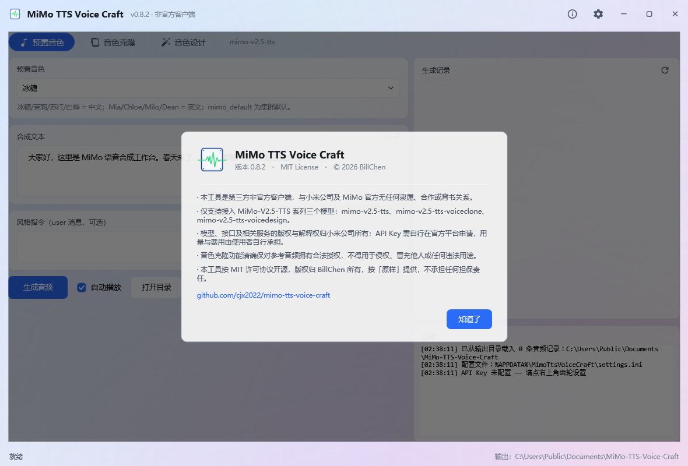

<div align="center">


# MiMo TTS Voice Craft

**非官方** MiMo-V2.5-TTS 语音合成桌面工作台 · Windows / .NET 8 / WPF

版本 **0.8.2** · MIT License · © 2026 BillChen

</div>

---

> ## ⚠️ 非官方声明
>
> 本项目是**第三方非官方客户端**，与**小米公司及 MiMo 官方无任何隶属、合作或背书关系**。
>
> - 仅支持接入 **MiMo-V2.5-TTS 系列三个模型**：`mimo-v2.5-tts`、`mimo-v2.5-tts-voiceclone`、`mimo-v2.5-tts-voicedesign`
> - 模型、接口及相关服务的**版权与解释权归小米公司所有**；API Key 需自行在[官方平台](https://platform.xiaomimimo.com/console/api-keys)申请，用量与费用由使用者自行承担
> - 音色克隆功能请确保**对所使用参考音频拥有合法授权**，不得用于侵权、冒充他人或任何违法用途
> - 本工具按「原样」提供，不承担任何担保责任

---

## 功能

| 模块 | 说明 |
|---|---|
| **预置音色** | `mimo-v2.5-tts`：冰糖 / 茉莉 / 苏打 / 白桦（中文），Mia / Chloe / Milo / Dean（英文），`mimo_default` 跟随集群 |
| **音色克隆** | `mimo-v2.5-tts-voiceclone`：mp3 / wav 参考音频（Base64 ≤ 10MB），自动校验格式与体积 |
| **音色设计** | `mimo-v2.5-tts-voicedesign`：6 个维度下拉（性别年龄 / 音色质感 / 情绪语气 / 语速节奏 / 角色人设 / 使用场景，各含预设与「其它」自填）+ 补充描述，实时预览拼装出的音色描述 |
| **文本控制** | 开头 `(风格)` 标签、文中 `[音频标签]`（吸气 / 停顿 / 情绪 / 哭笑等），与自然语言风格指令可叠加 |
| **字数统计** | 合成文本框右上角实时显示字数；音色设计模式显示 `N / 300 字`，接近上限转警示色、超限直接拦截提交（该模型超出后不会报错，只会**静默前后丢字**） |
| **输出格式** | wav / mp3 / pcm / pcm16（pcm 为无文件头裸流，24kHz 单声道 16bit） |
| **播放器** | 内嵌播放 / 暂停 / 拖动定位，自动播放可开关；播放前插入数字静音前导，规避部分声卡起播丢首缓冲导致的「吞字」 |
| **记录管理** | 启动自动列出输出目录音频，支持重命名、单项删除（文件移入回收站） |
| **界面** | 无边框自绘窗口、炫彩渐变玻璃质感、软件渲染（省显存内存） |

## 界面

| 主界面 | 音色设计 | 关于 / 版权申明 |
|---|---|---|
|  |  |  |

## 环境要求

- Windows 10 1607+ / Windows 11
- [.NET 8 Desktop Runtime](https://dotnet.microsoft.com/download/dotnet/8.0)（框架依赖版 exe 需要；自包含版不需要）
- 一个 MiMo 平台 API Key（[控制台获取](https://platform.xiaomimimo.com/console/api-keys)）

## 使用

1. 运行 `mimo-tts-voice-craft.exe`
2. 点右上角 **⚙ 设置** → 填入 API Key（默认密文显示，可点「显示」查看）
3. 选择模型 → 填合成文本 →（可选）填风格指令 → **生成音频**
4. 生成结果自动保存到输出目录，并出现在右侧「生成记录」里，可播放、拖动进度、重命名、删除

**配置位置**：`%APPDATA%\MimoTtsVoiceCraft\settings.ini`（含 API Key、输出目录、输出格式、自动播放、静音前导等）

**版权与免责申明**：点右上角 **ⓘ** 随时查看。

## 从源码构建

```bat
git clone https://github.com/cjx2022/mimo-tts-voice-craft.git
cd mimo-tts-voice-craft
dotnet build -c Release
:: 单文件发布（框架依赖，约 800KB）
dotnet publish -c Release -o app -p:PublishSelfContained=false -p:PublishSingleFile=true
```

### 服务层探针

不启动界面即可验证三个模型的接口通路：

```bat
dotnet run --project _probe -- <your-api-key> [参考音频路径]
```

### 零干扰自检开关

用于开发验证，不弹窗、不抢焦点、不动鼠标（`--ghost` 会把窗口放到屏外并禁用激活）：

| 参数 | 作用 |
|---|---|
| `--ghost` | 离屏 + 不激活 + 近透明（配合下面参数使用） |
| `--opaque` | 配合 `--ghost`：保留不透明度，供 `PrintWindow` 像素采样 |
| `--screenshot=<path>` | 程序内渲染窗口为 PNG 后退出（不受 DWM / 遮挡影响） |
| `--page=design\|settings\|about\|rename\|delete` | 截图前直入指定界面 |
| `--audiotest=<path>` | 静音（Volume=0）自检播放器：自动播放 / 暂停 / 继续 / 定位 / 播完 / 切换 / 连点，结果写文件 |

`tools/` 下附带三个验证脚本：

| 脚本 | 用途 |
|---|---|
| `win_probe.py` | PrintWindow 抓窗口合成结果并采样（判断是否黑屏 / 玻璃层是否正常） |
| `png_sample.py` | PNG 反滤波 + 逐行扫描，检测背景是否有硬接缝 |
| `hittest_probe.py` | `SendMessage(WM_NCHITTEST)` 逐点验证标题栏按钮真的可点（避免按钮被当成拖动区） |

## 隐私

- API Key 仅保存在本机 `%APPDATA%\MimoTtsVoiceCraft\settings.ini`，**只用于直连** `api.xiaomimimo.com`，程序不含任何统计、上报或第三方转发
- 音频与文本只在你的机器与官方接口之间流转，不经过作者或任何中间服务器

## 许可

[MIT License](LICENSE) © 2026 BillChen

使用本工具即表示你已知悉：它是非官方第三方作品，与小米 / MiMo 官方无关；因使用本工具产生的任何后果由使用者自行承担。
